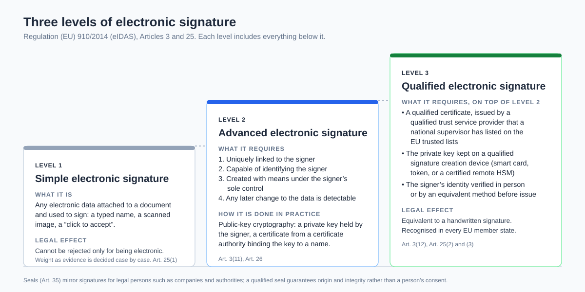
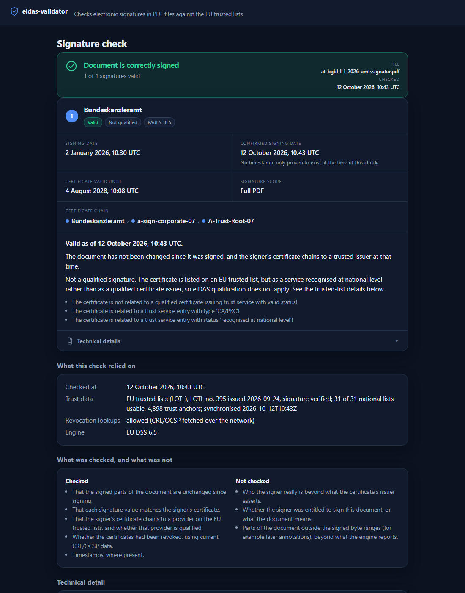

# eIDAS signature validator

[](https://github.com/juraj-jumic/eidas-validator/actions/workflows/ci.yml)

A free, self-hostable tool that tells ordinary people, in plain language, whether a signed PDF
carries a valid, and qualified, electronic signature under EU rules (eIDAS).

**Status: milestone M1, trusted lists.** It validates PAdES signatures with [EU DSS](https://github.com/esig/dss),
loads the EU list of trusted lists (LOTL) and the national lists it points to, determines the
eIDAS qualification of each signature, and explains the outcome. Every report names the LOTL
sequence number, issue date and synchronisation time it relied on.

This tool is informational. It is not a qualified validation service in the sense of eIDAS,
and its output is not legal advice.

## Understanding what is being checked

A signed PDF carries a chain of claims: that these bytes were signed with a particular key, that
the key belongs to a named person or organisation, that the issuer of that claim is itself
vouched for by a national supervisor, and that none of it had been withdrawn at the time. The
guide below explains each link in plain language, with diagrams.



**[How electronic signatures work](docs/how-electronic-signatures-work.md)** covers:

| Section | What you will learn |
| --- | --- |
| [Three levels of signature](docs/how-electronic-signatures-work.md#2-three-levels-of-signature) | Simple, advanced and qualified; what each requires and what the law says about it |
| [Certificates](docs/how-electronic-signatures-work.md#3-certificates-the-identity-papers-of-a-key) | What is inside a certificate and which kind makes a signature qualified |
| [Trust architecture](docs/how-electronic-signatures-work.md#4-who-vouches-for-whom-the-trust-architecture) | From the Commission's list of trusted lists down to the signer's key |
| [Inside a PDF](docs/how-electronic-signatures-work.md#5-how-a-signature-is-placed-inside-a-pdf) | Incremental updates, byte ranges and the CMS container |
| [Tamper protection](docs/how-electronic-signatures-work.md#6-tamper-protection) | Why a single changed byte fails verification |
| [Lifetime](docs/how-electronic-signatures-work.md#7-how-long-a-signature-stays-verifiable) | The four baseline levels and how long each stays verifiable |
| [Validation](docs/how-electronic-signatures-work.md#8-validation-step-by-step) | The eight steps and the three possible outcomes |

## Build and run

Requires JDK 17+ and Maven.

```bash
mvn package
```

```bash
java -jar target/eidas-validator.jar path/to/signed.pdf
```

Options:

| Option | Meaning |
| --- | --- |
| `--at <ISO instant>` | Validate as of this time instead of now (reproducible results) |
| `--no-trusted-lists` | Skip the EU trusted lists; integrity and chain checks against `--trust` anchors only |
| `--offline` | No network at all: trusted lists from the cache, no revocation lookups |
| `--online` | Allow CRL, OCSP and AIA fetches for the signer's chain (off by default) |
| `--cache-dir <dir>` | Trusted-list cache (default `~/.eidas-validator/tl-cache`) |
| `--tl-max-age <hours>` | Re-download lists older than this (default 24) |
| `--lotl-signers <file>` | Override the bundled LOTL signing certificates |
| `--trust <cert>` | Accept an extra PEM/DER certificate as a trust anchor (repeatable) |
| `--lang <tag>` | Language of the explanations: `en` (default), `de` or `hr`; others fall back to English |
| `--json` | Machine-readable report (version 4) instead of text |
| `--html <file>` | Also write the readable, self-contained HTML report |
| `--engine-report <file>` | Save the DSS simple report XML for the technical view |

Exit codes: `0` valid, `1` invalid, `2` indeterminate, `3` no signature, `4` could not validate.

## Local web interface

```bash
java -jar target/eidas-validator.jar serve
```

Then open http://127.0.0.1:8765/ (change with `--port`; the trust options above apply too).
Choose a PDF, optionally allow online revocation checks, and you get the report; add a
`format=json` field to the form post for JSON.



The report leads with the verdict, then one card per signature: who signed, whether the
signature is valid and qualified, the signing date and the earliest moment the signature is
proven to have existed, how long the certificate is valid, whether the signature covers the
whole PDF, the certificate chain up to the trust anchor, the plain-language reading, and the
technical facts (byte range, signature field, algorithm, engine codes) behind a disclosure.
Dark and light schemes follow the system setting.

The server binds to the loopback interface only and refuses requests whose `Host` header is not
a loopback name or whose `Origin` is another site, so pages you visit elsewhere cannot post to
it. Uploads are capped at 50 MB, written to a private temporary file and deleted after the
check. Responses are not cached and carry a strict Content-Security-Policy; the pages need no
JavaScript. Trusted lists are loaded once at start and refreshed when older than `--tl-max-age`.

## Languages

Every sentence a reader sees lives in a message catalog,
[messages.properties](src/main/resources/org/eidasvalidation/messages.properties) (English, the
base and fallback) and one `messages_<lang>.properties` per translation; German
(`messages_de.properties`) and Croatian (`messages_hr.properties`) ship with the tool. The
Croatian wording follows the official Croatian text of eIDAS and the Croatian implementing
act (*pouzdani popis*, *pružatelj usluga povjerenja*, *kvalificirano sredstvo za izradu
elektroničkog potpisa*) and is awaiting native proofreading. Explanations are keyed by the ETSI outcome (`failed.HASH_FAILURE.headline`,
`indeterminate.TRY_LATER.next`, `qualification.QESIG`, …), so wording for a new sub-indication
is a properties change, not a code change. The CLI takes `--lang`, the web interface follows
the browser's `Accept-Language`, and the JSON report records its `language`.

To add a language: copy `messages.properties` to `messages_<lang>.properties`, translate every
value, add the locale to `Messages.SUPPORTED`. A test fails the build if a translation is
missing a key, has a key the base lacks, or disagrees on placeholders.

## Test corpus

```bash
java -jar target/eidas-validator.jar corpus corpus/manifest.json --mode no-trusted-lists
```

Validates every file listed in [corpus/manifest.json](corpus/manifest.json) and compares the
outcome with the recorded expectation; `--mode full` uses the live trusted lists and online
revocation data, `offline` the local cache. The deterministic mode runs on every build and in
CI; the full mode runs in CI on pushes to `main`. See [corpus/README.md](corpus/README.md).

## Container

```bash
docker compose up -d
```

Builds the image and serves the web interface on http://127.0.0.1:8765/ with the trusted-list
cache in a named volume, a read-only root filesystem and a non-root user. The CLI works through
the same image:

```bash
docker run --rm -v "$PWD:/work:ro" eidas-validator:local /work/signed.pdf --no-trusted-lists
```

Inside the container the server binds to `0.0.0.0` (`serve --bind`), so reachability is decided
by the port mapping. The interface has no authentication: keep the mapping on `127.0.0.1`, or put
an authenticating reverse proxy in front and pass its name with `--allow-host`, which extends the
Host and Origin checks to that name. Images for version tags are published to
`ghcr.io/juraj-jumic/eidas-validator`; CI builds and smoke-tests the image on every push.

## Reports

The JSON report is the source of truth; the HTML report is rendered from it, so both always
agree. The HTML is one self-contained file: no scripts, no external resources, semantic
headings, verdict stated in words with colour only as an accent, and the engine's own report
behind a disclosure. It states what was checked and what was not, and which trusted-list
version and time the verdict refers to.

## Trust data

The first run downloads the LOTL from `https://ec.europa.eu/tools/lotl/eu-lotl.xml` and the
national trusted lists (a few megabytes, roughly a minute). They are cached on disk, so later
runs are fast and `--offline` works from the cache.

The LOTL's own signature is verified against the certificates the European Commission announced
in the Official Journal; a copy ships in the jar as `lotl-signers.pem` (see
`src/main/resources/lotl-signers.pem` for its provenance). A list whose signature does not
verify is rejected; an expired list is used but flagged in the report. Only trusted-list and
revocation data ever cross the network; the document stays on your machine.

The online trusted-list test is opt-in: `EIDAS_TL_ONLINE=true mvn test`.

**Guarded fetching.** A validator follows URLs found inside the document's certificates (CRL
distribution points, OCSP responders, AIA issuer links), which an attacker controls. All network
access, including trusted-list downloads, goes through one guarded fetcher
(`org.eidasvalidation.net.GuardedFetcher`) that allows only `http`/`https`, refuses loopback,
private, link-local (cloud metadata), multicast and reserved addresses, pins each connection to
the vetted address so a DNS rebinding cannot bypass the check, vets redirect targets the same
way (max 3), and enforces connect/read/total timeouts and a byte limit (4 MB for revocation data,
32 MB for trusted lists). Nothing is fetched at all without `--online` or the trusted-list refresh.

**Parsing in a sandbox.** A PDF parser is a large attack surface, and a hostile file can make
it hang, exhaust memory or crash. The web interface therefore parses documents in a
supervised worker JVM (`org.eidasvalidation.sandbox`): the worker loads trust data once and
handles one document at a time under a heap cap (`--sandbox-memory`, default 1 GB),
`ExitOnOutOfMemoryError`, its own temporary directory and a wall-clock limit per document
(`--sandbox-timeout`, default 60 s). A worker that overruns is killed, a worker that dies is
reported, and the next request gets a fresh one; the server itself never goes down, and the
reader sees "this file could not be checked safely" with the reason. `serve --no-sandbox`
turns this off; the CLI opts in with `--sandbox`. The container adds the operating-system
layer on top: non-root, read-only root filesystem, no new privileges.

**TLS to the list servers.** National lists are served from hosts whose roots (HARICA, FNMT-RCM,
Certum, Microsec, GlobalSign R46, ...) are missing from older JDK `cacerts` files; an original
JDK 17 GA build fails on several of them with "PKIX path building failed". Use a current JDK
update (17.0.x latest or 21). The tool also enables AIA fetching of missing intermediates and, on
Windows, uses the operating system's root store unless `javax.net.ssl.trustStoreType` is already
set. A list that cannot be fetched is named in the report's trust notes, not silently skipped.

## Layout

```
src/main/java/org/eidasvalidation/
  engine/        engine-neutral request, result and ValidationEngine interface
  engine/dss/    EU DSS implementation
  explain/       maps ETSI indications and qualifications to plain language
  report/        versioned JSON report model and the HTML renderer
  service/       loads trust data once, validates documents (shared by CLI and web)
  net/           guarded fetcher: the only code that opens network connections
  web/           local web interface (loopback only)
  cli/           command line: validate (default) and serve
src/test/java/   generates its own signed PDFs with a throwaway certificate
corpus/          test corpus manifest (see corpus/README.md)
docs/            project brief and design notes
```

## Licence

MIT. EU DSS is LGPL-2.1 and is used unmodified as a library; see [NOTICE](NOTICE).
