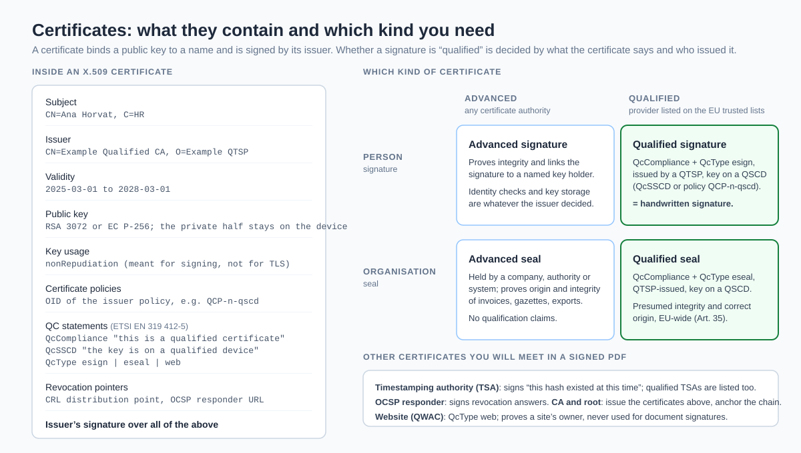
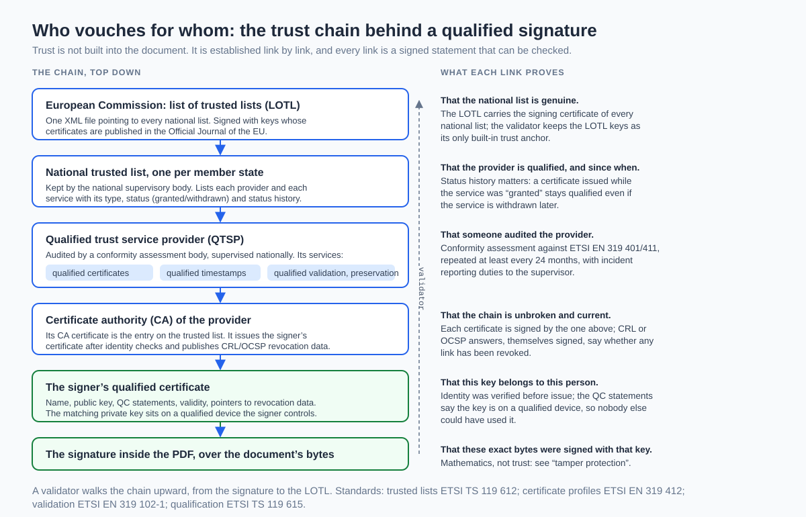
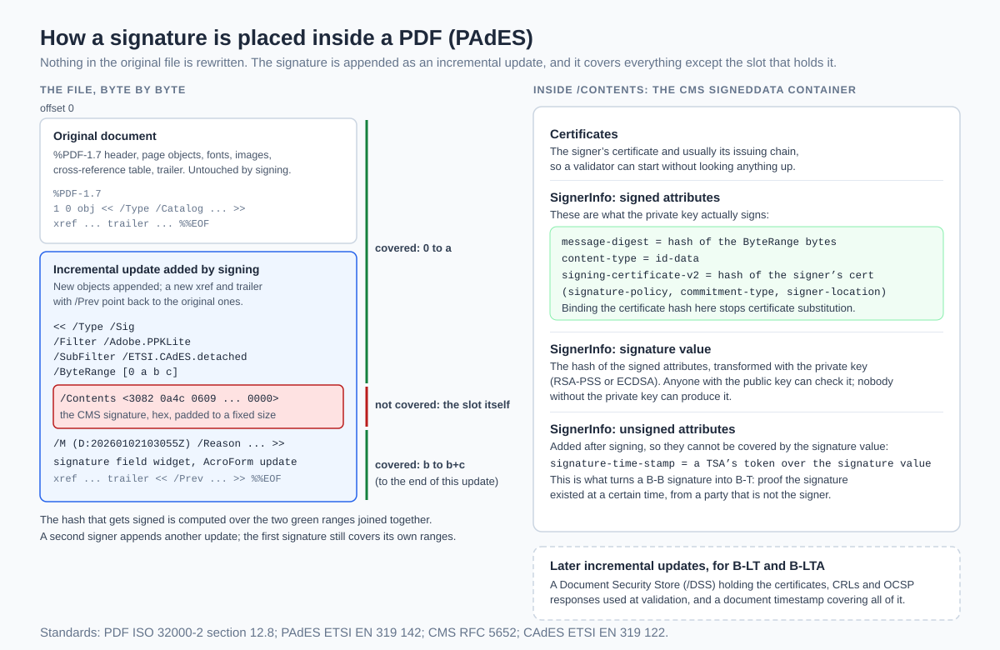
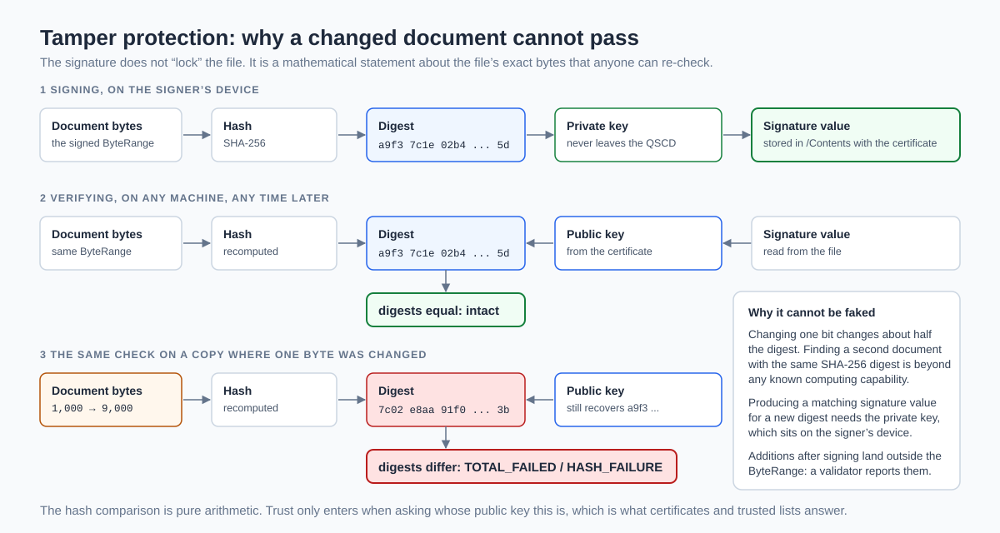
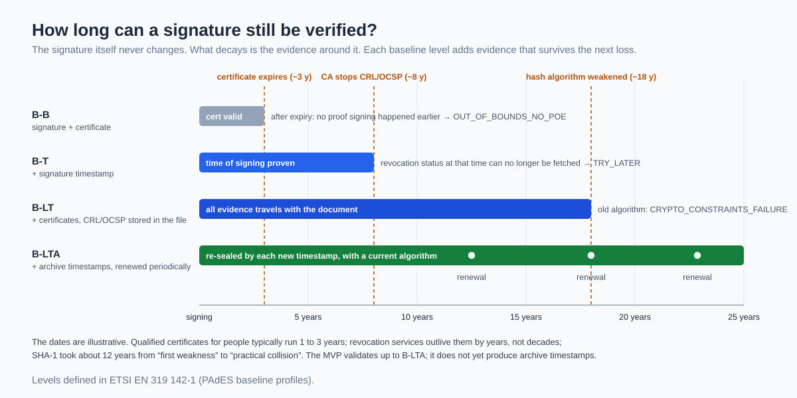
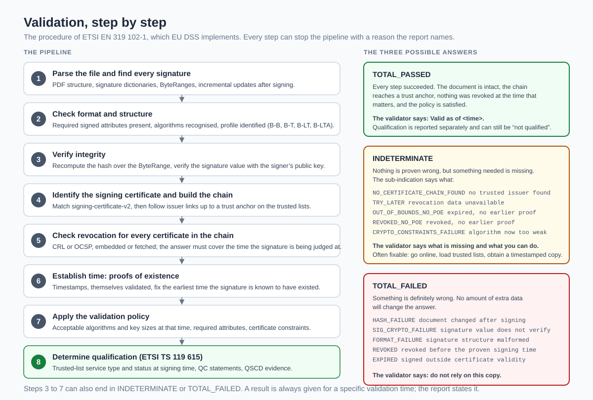

# How electronic signatures work

A plain-language guide to what this validator checks and why the answer can be trusted. No prior knowledge of cryptography or EU law is assumed. Where a standard or an article of the law is the source, it is named so you can look it up.

**Contents**

1. [What problem a signature solves](#1-what-problem-a-signature-solves)
2. [Three levels of signature](#2-three-levels-of-signature)
3. [Certificates: the identity papers of a key](#3-certificates-the-identity-papers-of-a-key)
4. [Who vouches for whom: the trust architecture](#4-who-vouches-for-whom-the-trust-architecture)
5. [How a signature is placed inside a PDF](#5-how-a-signature-is-placed-inside-a-pdf)
6. [Tamper protection](#6-tamper-protection)
7. [How long a signature stays verifiable](#7-how-long-a-signature-stays-verifiable)
8. [Validation, step by step](#8-validation-step-by-step)
9. [Reading this validator's report](#9-reading-this-validators-report)
10. [Glossary](#10-glossary)

---

## 1. What problem a signature solves

A handwritten signature on paper does three jobs at once. It shows *who* agreed, it shows *what* they agreed to (the page it sits on), and it is hard to move to another page without leaving traces. An electronic signature has to do the same three jobs for a file that can be copied perfectly and edited invisibly.

The answer the industry settled on is public-key cryptography. The signer holds a secret, the **private key**. A matching **public key** is handed out to everyone. Anything transformed with the private key can be checked with the public key, but not produced with it. Sign the fingerprint of a document with the private key, and anyone can confirm that whoever held that key signed exactly those bytes.

That still leaves the question *whose* key it is. Mathematics cannot answer it. That is what certificates, trust service providers and the EU trusted lists are for, and it is where most of the complexity, and most of the legal weight, lives.

## 2. Three levels of signature

EU law (Regulation 910/2014, "eIDAS") does not have one notion of electronic signature. It has three, stacked on top of each other.

**Simple.** Anything electronic used to sign: a typed name under an email, a pasted image of a signature, a click on "I accept". Courts may not throw it out just for being electronic (Art. 25(1)), but nothing about it is technically verifiable. It proves intent only as far as the surrounding evidence does.

**Advanced** (AdES, Art. 26). The signature must be uniquely linked to the signer, able to identify them, created with means under their sole control, and any later change to the signed data must be detectable. In practice this always means a cryptographic signature with a certificate. Any certificate authority can issue the certificate, and the quality of its identity checks is whatever the issuer decided.

**Qualified** (QES, Art. 3(12)). An advanced signature with two more guarantees: the certificate is a *qualified certificate* issued by a *qualified trust service provider* that a national supervisor has placed on the EU trusted lists, and the private key lives on a *qualified signature creation device* (a smart card, a USB token, or a certified remote signing service with a hardware security module). Identity is verified before the certificate is issued, in person or by an equivalent method. The reward is Art. 25(2): a qualified electronic signature has the legal effect of a handwritten one, and Art. 25(3): every member state must recognise it.

Companies and public bodies have the same ladder for **seals** (Art. 35). A seal does not express a person's consent; it proves that a document originates from an organisation and has not been altered since. The gazette files in this project's test corpus are sealed, not signed.

## 3. Certificates: the identity papers of a key

A certificate is a small signed document that says "this public key belongs to this name, and I, the issuer, vouch for it until this date". The format is X.509, the same one websites use, with a profile for electronic signatures defined in ETSI EN 319 412.

The fields that decide what a signature *is*:

- **Subject** and **issuer**: who holds the key and who vouches for them.
- **Validity**: a signature made outside this window is suspect unless a timestamp proves otherwise.
- **Key usage**: a signing certificate carries `nonRepudiation`; a TLS certificate does not. Using the wrong kind is a policy failure.
- **QC statements** (ETSI EN 319 412-5): the issuer's own declarations. `QcCompliance` says "this is a qualified certificate", `QcSSCD` says "the key is on a qualified device", `QcType` says whether it is for a person's signature, an organisation's seal, or a website.
- **Certificate policies**: an identifier such as `QCP-n-qscd` that encodes the same facts in the issuer's policy language.
- **Revocation pointers**: where to ask whether this certificate has been withdrawn (a CRL download address, an OCSP responder).

A validator reads these fields, but it does not take them at face value. A certificate can say `QcCompliance` all it likes; it is only qualified if its issuer is on a trusted list as a qualified certificate service, with status *granted* at the time of signing. The claim inside the certificate and the entry on the list must agree.

You will meet other certificates inside a signed PDF: the **timestamping authority** that signs "this hash existed at this time", the **OCSP responder** that signs revocation answers, and the CA and root certificates that hold the chain together. Each is validated the same way.

## 4. Who vouches for whom: the trust architecture

Trust is not built into a signed document. It is established link by link, and every link is a signed statement that can be checked:

1. The **European Commission** publishes the *list of trusted lists* (LOTL), one XML file pointing to every national list. It is signed with keys whose certificates are announced in the Official Journal. Those certificates are the only trust anchor this validator carries built in.
2. Each **member state** keeps a *trusted list* (ETSI TS 119 612) naming every qualified trust service provider and service in its territory, with the service type, its current status, and its status history. The history matters: a certificate issued while a service was "granted" stays qualified even if the service is withdrawn later.
3. A **qualified trust service provider** is audited by a conformity assessment body against ETSI EN 319 401 and 411, re-audited at least every two years, and supervised nationally. Its services include qualified certificates, qualified timestamps and, sometimes, qualified validation and preservation.
4. The provider's **certificate authority** is the entry on the trusted list. It issues the signer's certificate after identity checks and publishes revocation data.
5. The **signer's certificate** binds a name to a public key; the private key sits on a device the signer controls.
6. The **signature** covers the document's bytes.

A validator walks this chain upward from the signature: find the signer's certificate, find its issuer, find that issuer on a trusted list, confirm the list is referenced by the LOTL, confirm the LOTL signature with the Official Journal keys. Every report this tool produces names the LOTL sequence number and issue date it relied on, so the reasoning can be repeated.

## 5. How a signature is placed inside a PDF

PDF signatures follow PAdES (ETSI EN 319 142), which builds on the signature mechanism in the PDF standard itself (ISO 32000-2, section 12.8).

Nothing in the original file is rewritten. Signing appends an **incremental update**: new objects, a new cross-reference table, and a trailer pointing back to the previous one. Among the new objects is the signature dictionary. Its two important entries are `/ByteRange`, four numbers describing two stretches of the file, and `/Contents`, a hex string holding the actual signature. The byte ranges cover everything in the file except the `/Contents` slot itself, which has to be excluded because the signature cannot cover its own value.

The `/Contents` slot holds a **CMS SignedData** container (RFC 5652, profiled by CAdES, ETSI EN 319 122). Inside:

- The signer's certificate, usually with its issuing chain, so a validator can start without looking anything up.
- The **signed attributes**: the hash of the byte ranges (`message-digest`), the hash of the signer's certificate (`signing-certificate-v2`, which stops anyone swapping in a different certificate), and optionally a commitment type or signature policy. These attributes are what the private key actually signs.
- The **signature value**: the hash of the signed attributes transformed with the private key.
- The **unsigned attributes**, added after signing: typically a *signature timestamp* from a timestamping authority, which proves the signature existed at a certain moment.

A second signer adds another incremental update; the first signature still covers exactly its own ranges. Long-term profiles add further updates: a *Document Security Store* with the certificates and revocation data that were used, and a *document timestamp* over all of it.

## 6. Tamper protection

The signature does not lock the file. It is a statement about the file's exact bytes, and the statement is checked by arithmetic:

1. **Signing.** Hash the byte ranges with SHA-256 to get a 32-byte digest. Transform the digest with the private key, on the signer's device. Store the result, with the certificate, in `/Contents`.
2. **Verifying.** Hash the same byte ranges again. Recover the signer's digest from the signature value using the public key from the certificate. Compare.
3. **After a change.** Alter one byte anywhere in the covered ranges, and about half the bits of the digest change. The comparison fails. The report says `TOTAL_FAILED / HASH_FAILURE`: the document was changed after it was signed.

Why this cannot be worked around: finding a second document with the same SHA-256 digest is beyond any known computing capability, and producing a matching signature value for a new digest requires the private key, which is on the signer's device. Trust enters only at the question "whose public key is this?", which sections 3 and 4 answered.

Additions after signing, such as a later annotation or form fill, land in a new incremental update outside the signed byte ranges. They do not break the signature; the validator reports them as changes after signing, and a reader can see which revision was signed.

## 7. How long a signature stays verifiable

The signature never changes. What decays is the evidence around it: the certificate expires, the certificate authority eventually stops answering revocation queries, and in the long run the hash algorithm itself weakens. PAdES defines four **baseline levels** (ETSI EN 319 142-1) that add evidence to survive each loss.

- **B-B** (basic): signature and certificate. Verifiable while the certificate is valid and revocation data can be fetched. After expiry there is no proof the signature was made earlier, so the answer becomes `INDETERMINATE / OUT_OF_BOUNDS_NO_POE`.
- **B-T**: adds a signature timestamp. The signing time is now proven by a third party. But once the CA stops serving CRLs and OCSP, the revocation status at that time can no longer be established: `TRY_LATER`, forever.
- **B-LT** (long-term): embeds the certificates and the revocation responses that were used, so all evidence travels with the document. Verifiable until the algorithms age out.
- **B-LTA** (long-term with archive timestamps): adds a document timestamp that is renewed periodically with current algorithms, re-sealing all earlier evidence. This is what archives use for signatures that must hold for decades.

This validator checks all four levels. It does not yet add timestamps or produce archive-level documents; that is signing-side work for a later phase.

## 8. Validation, step by step

ETSI EN 319 102-1 defines the procedure, and EU DSS, the engine inside this tool, implements it. In order:

1. **Parse** the file and find every signature, its byte ranges and any updates after it.
2. **Format and structure**: required signed attributes present, algorithms recognised, profile identified.
3. **Integrity**: recompute the hash, verify the signature value with the public key.
4. **Chain**: identify the signing certificate (it must match `signing-certificate-v2`), then follow issuer links to a trust anchor on the trusted lists.
5. **Revocation** for every certificate in the chain, from embedded or fetched CRL/OCSP data, covering the time the signature is judged at.
6. **Time**: validate timestamps to fix the earliest moment the signature is known to have existed (the *proof of existence*), and derive the *best signature time*.
7. **Policy**: acceptable algorithms and key sizes for that time, required attributes, certificate constraints.
8. **Qualification** (ETSI TS 119 615): trusted-list service type and status at signing time, QC statements, QSCD evidence. Result: qualified signature, advanced signature with a qualified certificate, advanced signature, or not qualified.

The outcome vocabulary is fixed by the standard and this tool keeps it visible under the plain-language text:

| Outcome | Meaning | What the report says |
| --- | --- | --- |
| `TOTAL_PASSED` | Every step succeeded for the validation time. | Valid as of \<time\>. Qualification stated separately. |
| `INDETERMINATE` | Nothing proven wrong, but something needed is missing. The sub-indication names it. | What is missing and what you can do: go online, load trusted lists, get a timestamped copy. |
| `TOTAL_FAILED` | Something is definitely wrong; more data will not change it. | Do not rely on this copy. |

Two points that surprise people. First, a result is always *as of* a specific time; the same file can be `TOTAL_PASSED` today and `INDETERMINATE` in five years if nobody added evidence. Second, **valid** and **qualified** are independent axes: a signature can be perfectly valid and not qualified (the Austrian gazettes in the test corpus are exactly that), and a signature from a qualified certificate can fail validation.

## 9. Reading this validator's report

Every report, in the terminal, as JSON or as HTML, carries the same four blocks:

1. **The verdict in words**: *Valid as of 11 October 2026, 20:35 UTC*, *The document was changed after it was signed*, *The document is intact, but the signer is not linked to any trusted issuer*. Never "legally valid": that is a judgement for a court, not a program.
2. **The qualification line**, with the trusted-list facts behind it: which service type and status the signer's certificate authority has on its national list.
3. **What the check relied on**: the LOTL sequence number and issue date, how many national lists were usable, when they were synchronised, whether revocation lookups were allowed. If a national list could not be fetched or its signature did not verify, the report says which one.
4. **What was checked and what was not.** The tool checks bytes, chains, revocation, time and listing. It does not check who the signer really is beyond what their certificate's issuer asserts, whether they were entitled to sign, or what the document means.

The engine's own report, in ETSI vocabulary, sits one click away for anyone who needs it.

## 10. Glossary

| Term | Meaning |
| --- | --- |
| **AdES / QES** | Advanced / qualified electronic signature (Art. 26 / Art. 3(12) eIDAS). |
| **CA** | Certificate authority: issues certificates and publishes revocation data. |
| **CAdES / PAdES / XAdES** | Signature formats for CMS containers, PDF files and XML (ETSI EN 319 122 / 142 / 132). |
| **CMS** | Cryptographic Message Syntax (RFC 5652), the container inside `/Contents`. |
| **CRL / OCSP** | Certificate revocation list / online certificate status protocol: two ways to learn whether a certificate was withdrawn. |
| **DSS** | Two things: *Digital Signature Service*, the European Commission's open-source engine this tool uses; and *Document Security Store*, the PDF structure holding long-term validation data. |
| **LOTL** | List of trusted lists, published by the Commission, pointing to every national list. |
| **POE** | Proof of existence: evidence, usually a timestamp, that something existed at a given time. |
| **QC statements** | Fields in a certificate where the issuer declares it qualified, on a qualified device, and for which purpose. |
| **QSCD** | Qualified signature creation device: certified hardware or service holding the private key. |
| **QTSP** | Qualified trust service provider: audited and listed on a national trusted list. |
| **Seal** | The organisation's counterpart of a signature: proves origin and integrity, not consent. |
| **Trusted list** | A member state's signed list of qualified providers and services, with status history (ETSI TS 119 612). |
| **TSA** | Timestamping authority: signs a hash together with the current time. |

---

*This guide describes the standards and the law as of October 2026. It is an explanation, not legal advice, and this tool is not a qualified validation service in the sense of Art. 32 and 33 eIDAS.*
